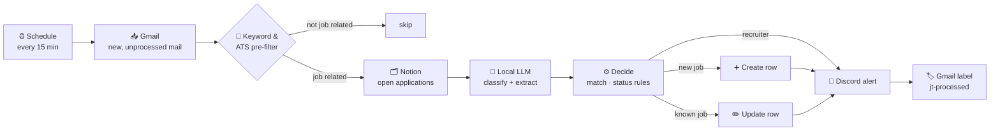

# AI Job Application Tracker

**An n8n automation that reads your Gmail, uses a self-hosted LLM to understand replies from employers, keeps a Notion job tracker up to date, and pings you on Discord when something important happens.**


---

## The problem

When you apply to dozens of jobs, replies get buried: automated confirmations, assessment invites, interview requests and rejections all land in the same inbox. Keeping a spreadsheet up to date by hand is tedious, and it's easy to miss a deadline.

## The solution

This workflow runs every 15 minutes and does the bookkeeping for you:

- 📥 **Finds job-related emails** in Gmail (confirmations, recruiter replies, ATS notifications) and ignores everything else.
- 🧠 **Understands each email with a local LLM**: is it a confirmation, rejection, interview invite, assessment, offer, request for information, or recruiter outreach? It also extracts the company, role, a short summary, the next step and any deadline.
- 🗂️ **Updates a Notion database** automatically: a new row for each application, then status changes as replies come in (Applied → Assessment → Interview → Offer / Rejected).
- 🔔 **Notifies you on Discord** with a colour-coded message and links to the email and the Notion row.
- 📊 **Weekly digest** (optional): a Monday summary of your pipeline, and applications with no reply after 21 days are marked "No Response".

Email content never leaves your own infrastructure: classification runs on a self-hosted model (Ollama or any OpenAI-compatible server).

## Architecture



## How it works

| Step | Node(s) | What happens |
|---|---|---|
| 1 | **Get recent emails** | Fetches mail from the last 2 days that doesn't carry the `jt-processed` label yet (excluding Promotions, Social and your own sent mail). |
| 2 | **Pre-filter job emails** | A cheap keyword and sender check (Greenhouse, Lever, Workday, Ashby, SmartRecruiters…) drops newsletters and personal mail **before** anything reaches the LLM. |
| 3 | **Get open applications** | Loads your active applications from Notion so the LLM can match the email to one of them. |
| 4 | **Prepare LLM Input → Classify email** | Builds a structured prompt and asks the model for a JSON verdict: `email_type`, `company`, `role`, `matched_application`, `summary`, `next_action`, `deadline`. |
| 5 | **Decide** | Parses the answer (including from "thinking" models that reason before answering), picks the matching application and applies the status rules. |
| 6 | **Create / Update Notion row** | Writes the result through the Notion API. |
| 7 | **Discord** | Posts a confirmation line, or a colour-coded embed for replies. |
| 8 | **Mark email processed** | Labels the email so it is never processed twice. |

### Email types → Notion status

| LLM verdict | Status | Discord |
|---|---|---|
| `application_confirmation` | Applied (new row) | 📝 short line |
| `status_update`, `info_request` | Under Review | 🔄 / 📨 |
| `assessment` | Assessment | 🧩 orange |
| `interview_invite` | Interview | 🎉 green |
| `offer` | Offer | 🏆 gold |
| `rejection` | Rejected | ❌ red |
| `recruiter_outreach` | no row | 👋 purple |
| `other` | ignored | none |

### Matching a reply to an application
Checked in this order, from most to least certain:
1. **Same Gmail thread** as a known application
2. **Sender domain** equals the application's company domain (skipped for ATS and job-board senders)
3. The **LLM's pick** from the numbered list of open applications
4. **Company-name match** (normalises "Acme Inc." ↔ "Acme")

If nothing matches, a new row is created and flagged **Needs Review**.

### Status rules
- A status **never goes backwards**: a "still reviewing" email won't move an Interview back to Under Review.
- **Rejected** and **Offer** always apply.
- Closed applications (Rejected, No Response) are no longer matched against new emails.

## Engineering highlights

- **Robust LLM parsing.** Local "thinking" models often write notes before their JSON, sometimes containing stray braces. The Decide node scans for every balanced JSON object, ignores `<think>` blocks and code fences, and picks the one that has the expected keys.
- **Fail-safe retries.** If the model's answer can't be parsed, the email is left unlabelled and retried on the next run instead of being lost or misfiled.
- **Idempotent.** A Gmail label marks processed mail, so reruns, restarts and backfills never create duplicates.
- **Cheap by design.** Most mail is rejected by a regex pre-filter, and only plausible job emails cost an LLM call.
- **Privacy first.** No email text is sent to a third-party AI provider. Notion only stores a 1–2 sentence summary.
- **Tested.** The Code-node logic is covered by zero-dependency tests that run the exact JavaScript stored in the workflow file.
- **Secret-safe repo.** A pre-commit scanner blocks webhook URLs, API keys, OAuth secrets and IDs from ever being committed.

## Tech stack

| Area | Tools |
|---|---|
| Orchestration | n8n (self-hosted), Schedule trigger, Loop, Switch |
| AI | n8n Basic LLM Chain + Ollama Chat Model (or any OpenAI-compatible endpoint) |
| Integrations | Gmail API (OAuth 2.0), Notion REST API, Discord webhooks |
| Logic | JavaScript (n8n Code nodes) |
| Quality | Node.js test runner (no dependencies), secret-scanning pre-commit hook |

## Project structure

```
├── workflows/
│   ├── job-tracker.json          # main workflow: import this into n8n
│   └── weekly-digest.json        # optional Monday summary + "No Response" marking
├── src/                          # Code-node JavaScript, exported for easy reading
├── scripts/
│   ├── create-notion-database.js # creates the Notion database with the right schema
│   ├── export-code.js            # regenerates src/ from the workflow JSON
│   └── check-secrets.sh          # secret scanner (used as a pre-commit hook)
├── tests/run-tests.js            # unit tests for the Code nodes
└── docs/
    ├── SETUP.md                  # full step-by-step setup guide
    └── oauth-pages/              # home + privacy page templates for Google OAuth
```

## Quick start

You need a **self-hosted n8n** (1.x, with the AI/LangChain nodes), a **Gmail** account, a **Notion** workspace, a **Discord** server, and a **local LLM** (Ollama, LM Studio, vLLM…).

1. **Notion:** create an integration, then run `NOTION_TOKEN=… NOTION_PARENT_PAGE_ID=… node scripts/create-notion-database.js`
2. **Gmail:** create a Google OAuth client and connect it in n8n
3. **Discord:** create a channel webhook
4. **n8n:** import `workflows/job-tracker.json`, fill in the **Config** node, select your credentials and model
5. Send yourself a test email and click **Execute workflow**

👉 The full guide, with every click, is in **[docs/SETUP.md](docs/SETUP.md)**.

## Running the tests

```bash
node tests/run-tests.js      # Node 18+
```

<!--
## Screenshots

| Notion pipeline | Discord alerts | n8n workflow |
|---|---|---|
|  |  |  |
-->

## Privacy & security

Email content is processed only by the self-hosted n8n instance and LLM. No email text is sent to a
third-party AI service, and Notion stores only a short summary of each email.

## Roadmap

- [ ] Calendar event for interview invites and deadlines
- [ ] Auto-reply drafts for availability requests
- [ ] Support for Outlook / IMAP inboxes
- [ ] Dashboard of response rates per source (LinkedIn vs company site)

## License

[MIT](LICENSE) © 2026 Hamza Badar
